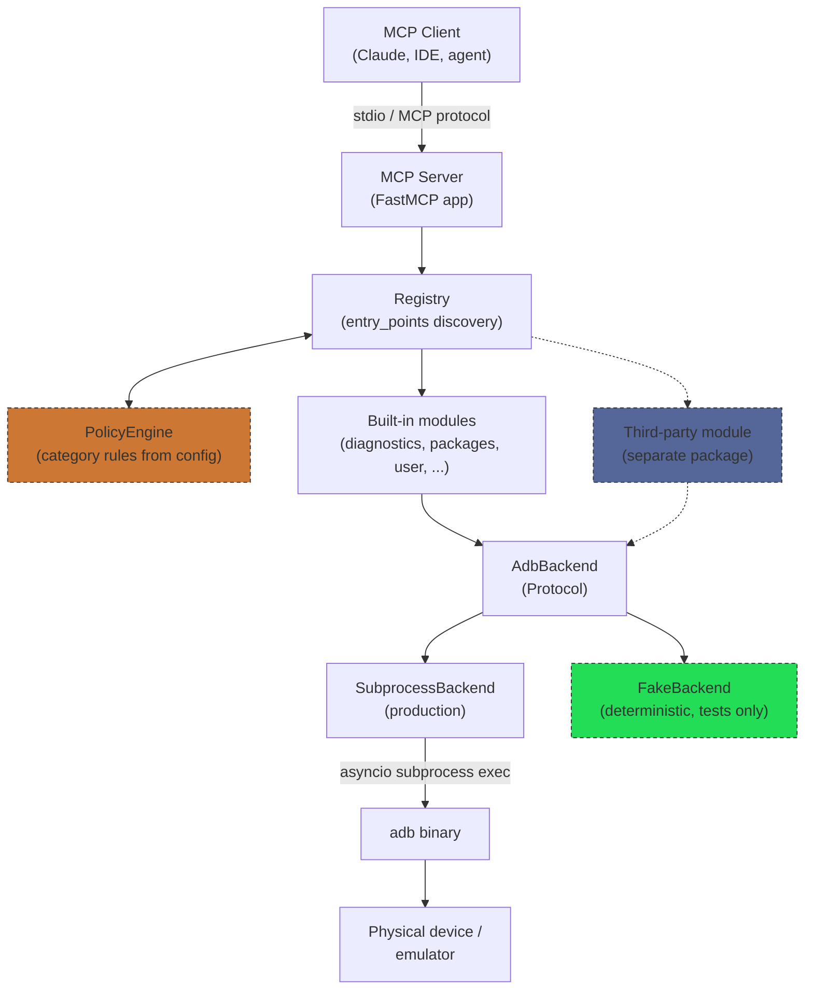
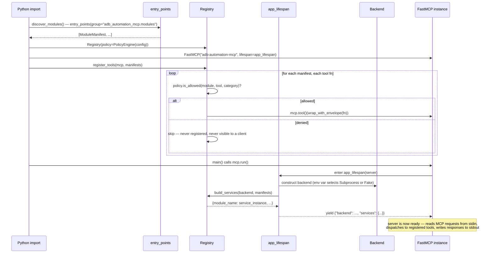
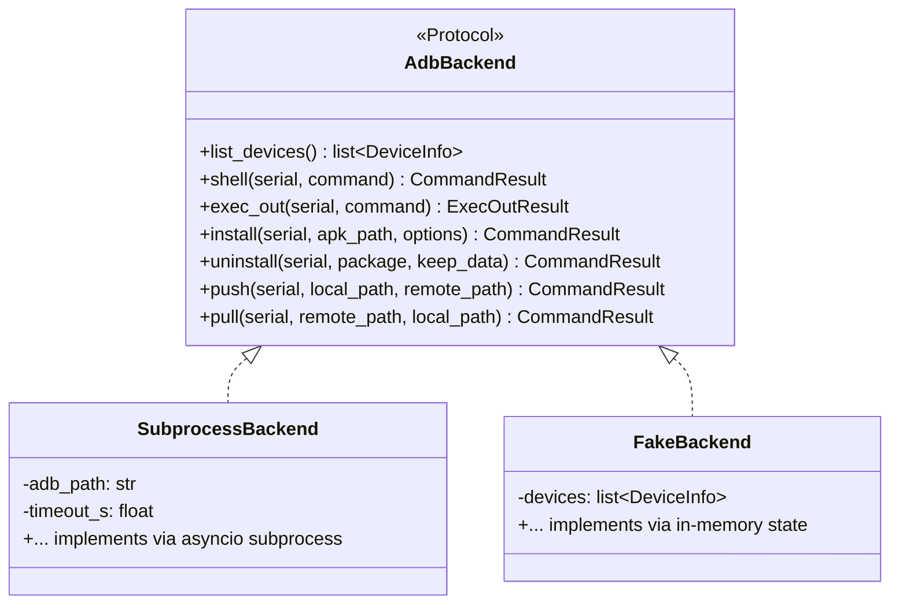
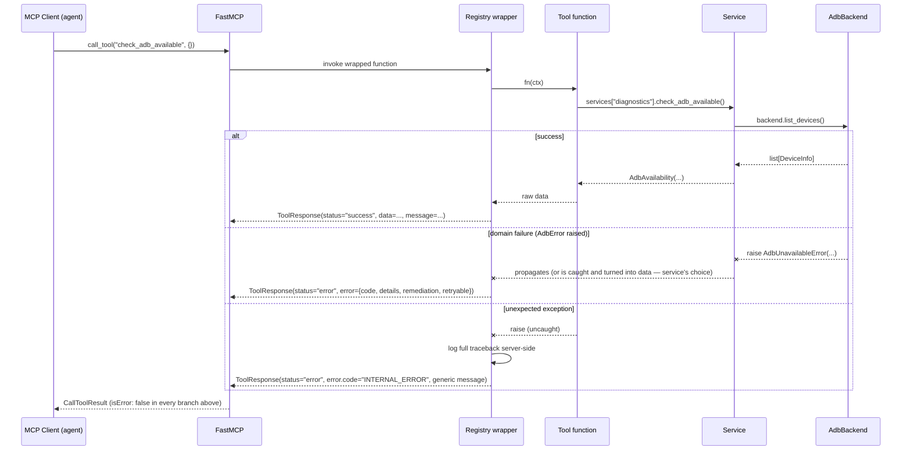
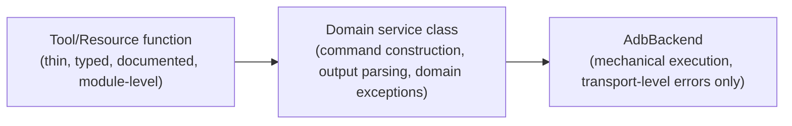

# Architecture

## 1. Overview

An MCP server that exposes Android Debug Bridge (ADB) capabilities to MCP clients
as typed, documented tools, over the `stdio` transport.

Design principles:

- Every behavior is verifiable without a physical device or emulator.
- Command domains are plugins; third-party packages can add modules without forking.
- No generic shell tool — every operation is a specific, named, parameterized tool.
- Policy controls which tools a server instance exposes, not who is calling them.

## 2. Component Architecture



Nothing above the `AdbBackend` line knows whether it's talking to a real device or a
fixture — that single seam is what makes "deterministic data for testing, real adb for
production" possible without special-casing tests inside module code.

The registry consults the `PolicyEngine` *before* handing a tool to `FastMCP` for
registration. A denied tool is never exposed to the MCP client at all.

## 3. How a Process Boots



Two phases matter here, and they happen in a specific order for a reason:

**Phase 1 — import time, static, no backend involved.** `discover_modules()` walks
Python `entry_points` for group `adb_automation_mcp.modules` and loads every registered
`ModuleManifest`. A `PolicyEngine` is built from config/env. A `Registry` is
constructed with that policy, and `register_tools` runs immediately — every tool
function gets a policy check and, if allowed, gets wrapped and handed to the
`FastMCP` instance. None of this needs a backend; it's pure wiring.

**Phase 2 — process start, per-run, backend-dependent.** `mcp.run()` starts the stdio
transport loop. Before the first request is served, `app_lifespan` runs once: it picks
a backend implementation (`SubprocessBackend` by default, `FakeBackend` if
`ADB_AUTOMATION_BACKEND=fake`), then asks the registry to build one service instance per
module, passing every service the *same* shared backend instance. That
`{"backend": ..., "services": {...}}` dict is what every tool call accesses for the
life of the process, via `Context.lifespan_context`.

The split matters: which tools *exist* is decided once, statically, independent of
which backend is running — a test harness that swaps in `FakeBackend` sees exactly
the same registered tool set a production run does.

## 4. Core Concepts

### Backend

`AdbBackend` is a `typing.Protocol` — structural typing, no forced inheritance —
defining the primitive operations every module is allowed to depend on. Modules never
call `subprocess` or know the string `"adb"` exists; they only see the Protocol.



`CommandResult` (`stdout`, `stderr`, `exit_code`, `duration_ms`) is returned uniformly
by both implementations, so module code and tests assert against the same shape
regardless of which backend is running underneath. `exec_out` is the one exception:
it returns `ExecOutResult`, identical but with `stdout` as raw `bytes` (not decoded),
for binary output such as `screencap -p`.

### Service

Each module's domain logic lives in a **service class** — e.g. `DiagnosticsService` —
constructed once at server startup with the shared backend instance
(`service_factory(backend)`, called by the registry). It owns command construction,
output parsing, and domain-specific exceptions; it's the only layer that knows what
adb's *output* actually means, as opposed to how to mechanically invoke adb.

### Tool

A thin, typed, documented, **module-level** async function — never a closure. It takes
a `Context` (for reaching services) plus whatever typed parameters the tool needs,
delegates essentially immediately to the service, and is tagged with
`@category("read" | "write" | "destructive")`.

### Registry

The central wiring component (`registry.py`). It:

- discovers module manifests via `entry_points`,
- asks the `PolicyEngine` whether each declared tool is allowed, at registration time,
- wraps allowed tools with the response-envelope translator,
- registers the wrapped function with the `FastMCP` instance,
- and, once per process (in the lifespan), builds one service instance per module
  from the shared backend.

### Policy Engine

Decides, once per server instance at registration time, which declared tools actually
get exposed to the client — based on a category default posture (`read`/`write`
allowed, `destructive` denied, unless configured otherwise) plus explicit
allow/deny lists by tool name. A denied tool simply doesn't exist as far as the client
(or the LLM driving it) can tell — it isn't listed, so there's no "permission denied"
round trip to reason about.

### Response Envelope

`ToolResponse[T]` / `ToolError` — Pydantic models. Every tool call returns the same
four-key shape:

```json
{
  "status": "success | error",
  "message": "one-line, human/agent-readable summary — always present",
  "data": "tool-specific payload on success, else null",
  "error": "present only when status is \"error\""
}
```

Backend and module code never construct this directly — they return data or raise a
typed `AdbError` subclass, and a single wrapper at the registry boundary
(`wrap_with_envelope`) converts whichever happened into the envelope. Tools that
produce files (e.g. `take_screenshot`) write them under `ADB_AUTOMATION_LOCAL_ROOT`
and return the path in the envelope.

## 5. How They Work Together — A Tool Call



Every branch produces a normal, `isError: false` MCP result — the client always gets
the envelope. Whether a service catches a backend exception and turns it into data
(as `DiagnosticsService.check_adb_available` does — "adb unreachable" is a legitimate
`available: false` answer) or lets it propagate up to become an error response (the
default — most failures genuinely are failures) is a per-service, per-method choice.

## 6. Module Internal Layering

Every module is structured in three layers, each with exactly one reason to change:



```python
# modules/diagnostics/service.py
class DiagnosticsService:
    def __init__(self, backend: AdbBackend) -> None:
        self._backend = backend

    async def check_adb_available(self) -> AdbAvailability:
        ...

# modules/diagnostics/tools.py
@category("read")
async def check_adb_available(ctx: Context) -> AdbAvailability:
    """..."""
    services = cast("dict[str, object]", ctx.lifespan_context["services"])
    diagnostics = cast(DiagnosticsService, services["diagnostics"])
    return await diagnostics.check_adb_available()

# modules/diagnostics/manifest.py
MODULE = ModuleManifest(
    name="diagnostics",
    service_factory=DiagnosticsService,
    tools=[check_adb_available],
    resources=[],
)
```

The tool function's body is essentially a one-line delegate call — almost redundant
with its own docstring. All the actual logic lives in the service class, which is
directly unit-testable with zero MCP/registry machinery involved:
`DiagnosticsService(FakeBackend(...)).check_adb_available()` in a plain `pytest` test.

`@category(...)` is a *transparent* marker decorator — it sets `fn.__adb_category__`
and returns the identical function object, nothing wrapped. The registry's own
envelope-wrapping (`functools.wraps`) preserves that marker automatically when it
wraps the function for registration.

## 7. Tools vs. Resources

Heuristic applied consistently across modules:

> **Tool** — if it takes meaningful parameters, has side effects, or is not safely
> re-invocable at will.
> **Resource** — if it's an idempotent, addressable, "GET-like" piece of device state
> a client might want to read/re-read/cache.

Tools are tagged individually with a category, which the policy layer filters on.
Resources are implicitly `read` and are registered through `Registry.register_resources`,
using a lighter, envelope-free error path. Device state is currently exposed as tools
(e.g. `list_connected_devices`), since not every MCP client surfaces resources to the
model.

## 8. Repository Layout

```
adb-automation-mcp/
├── pyproject.toml
├── uv.lock
├── mkdocs.yml                # docs site config — nav, theme, mkdocstrings
├── README.md
├── docs/                     # mkdocs source (user-facing site)
│   ├── index.md
│   ├── configuration.md      # env vars, saved files, safety controls, response format
│   ├── ARCHITECTURE.md       # contributor docs — excluded from the published site
│   ├── ADR.md                #   (see mkdocs.yml exclude_docs)
│   ├── reference/            # index.md overview + one page per module,
│   │                         # mkdocstrings-generated from tools.py
│   └── integrations/         # per-MCP-client setup guides
├── LICENSE
├── .github/
│   └── workflows/
│       ├── ci.yml            # lint, type-check, tests, docs build/deploy
│       └── publish.yml       # PyPI publish on GitHub release
├── src/
│   └── adb_automation_mcp/
│       ├── __main__.py
│       ├── server.py         # builds FastMCP app, lifespan, runs registry
│       ├── registry.py       # entry_points discovery, policy-filtered registration, envelope wrapping
│       ├── policy.py         # PolicyEngine
│       ├── errors.py         # AdbError hierarchy
│       ├── responses.py      # ToolResponse / ToolError
│       ├── backend/
│       │   ├── protocol.py   # AdbBackend Protocol, CommandResult, DeviceInfo
│       │   ├── subprocess_backend.py
│       │   └── testing.py    # FakeBackend
│       └── modules/
│           └── <module>/     # service.py, tools.py, manifest.py
└── tests/
    ├── meta/                 # registry contract (typing + docstrings)
    ├── unit/                 # per-module service tests
    └── e2e/                  # protocol-level, real fastmcp.Client
```

Single distribution (not a `uv` workspace of many packages) — built-in modules are
subpackages of `adb_automation_mcp`, registered through the same `entry_points` mechanism a
third-party plugin would use.

## 9. Testing

All tests run against `FakeBackend`; no device or emulator is required.

| Layer | Location | Scope |
|---|---|---|
| Registry contract | `tests/meta/` | Every registered tool is fully typed and has a complete docstring with an example. |
| Unit | `tests/unit/` | Each module's service class against `FakeBackend`, without MCP machinery. |
| Protocol E2E | `tests/e2e/` | A real `fastmcp.Client` against a `Registry`-wired server, covering registration, schema, and serialization. |

## 10. CI/CD

- **`ci.yml`** — on every push and pull request to `main`: `ruff check`, `mypy --strict`,
  `pytest`, and `mkdocs build --strict`. On push to `main`, the docs site is deployed
  to GitHub Pages.
- **`publish.yml`** — on a published GitHub release: builds with `uv build` and
  publishes to PyPI via trusted publishing.

Versioning follows [Semantic Versioning](https://semver.org/).
